<div align="center">

**English** · [简体中文](README.zh-CN.md)


# Lucet 光集

**Let your moments shine.**<br>
<sub>让每一个瞬间，自有光彩。</sub>

Make your photos look great on a Mac without learning photography first. When you do want to learn, it explains using your own photo.

One-click Auto · six plain sliders · presets you can see · save straight to Photos<br>
Photos, videos and Live Photos. A Mac color tool for DJI and iPhone shooters, in English and Chinese.

</div>

<p align="center">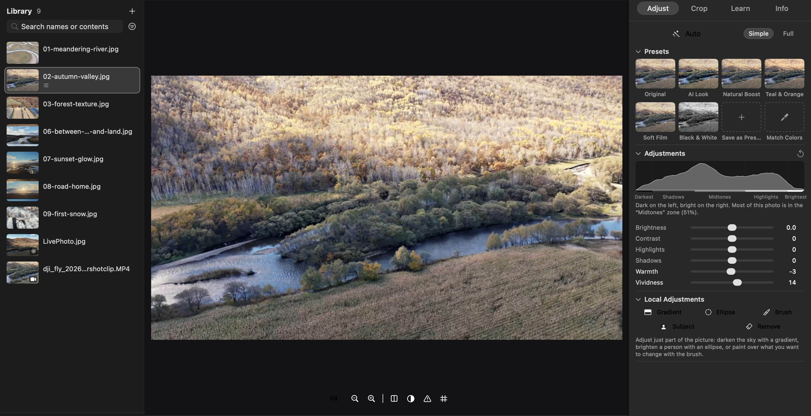</p>

### What it does to a photo

GitHub can't run a drag slider, so these sweep by themselves; on the [website](https://yaoyao021123.github.io/lucet/en/) you can drag the line yourself. All four are Lucet's real output, with no extra retouching.

<table>
<tr>
<td width="50%">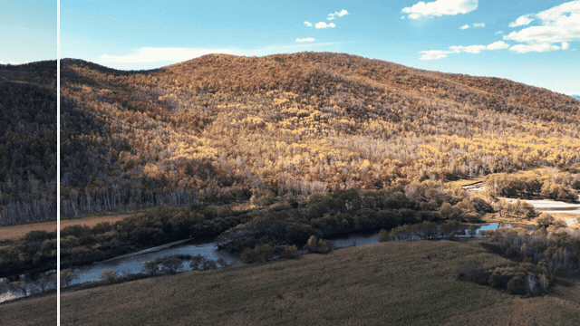<br><b>One-click Auto</b><br><sub>Left: original. Right: Auto.</sub></td>
<td width="50%">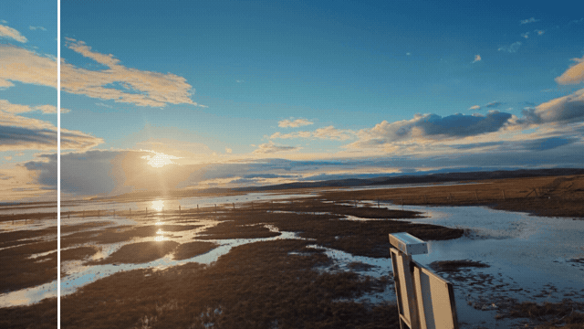<br><b>Local adjustments</b><br><sub>One gradient darkens the sky; the ground is untouched.</sub></td>
</tr>
<tr>
<td width="50%">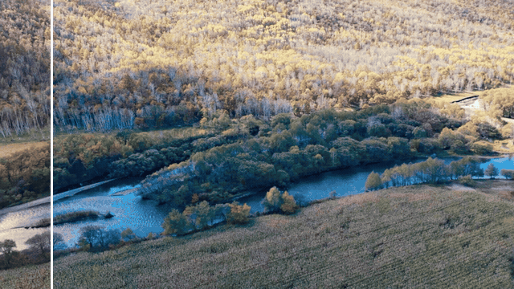<br><b>Match colors</b><br><sub>Moved toward the colors of a sunset photo.</sub></td>
<td width="50%">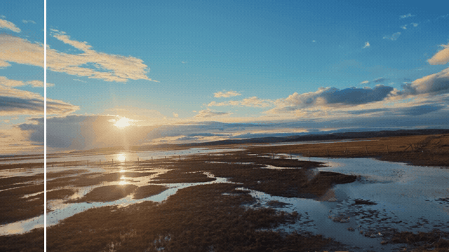<br><b>Remove</b><br><sub>Three brush strokes; the sign is filled in from its surroundings.</sub></td>
</tr>
</table>

## The story

### Where it started: an app that only exists on phones

I shoot with DJI gear. When I wanted to adjust the color and tone, I found that DJI Mimo only exists for phones (iOS and Android). To edit on a big screen, I had to go back to my phone.

Lightroom and Photoshop can do anything, of course. But the first thing you see is dozens of sliders you don't understand.

Lucet aims for the middle: **as simple as a phone app, on your Mac, with someone beside you to explain when you want to learn.** You get the handful of controls you'll use most; the full pro tools are all there, just tucked away.

### Find the problems first, then add features

The first prototype was written by ChatGPT; the repository's first commit is literally "Baseline: ChatGPT prototype as received". It ran, but it was slow and messy. I continued in Claude Code, and the first job wasn't new features but finding problems, each measured on a real Mac:

- Adding a folder of 2,000 files to the library took 6.9 seconds and froze the app; now it takes under 0.01 seconds.
- DJI Pocket 3's official Spring / Winter Pro LUTs failed to import (their titles are GBK-encoded); now they import, and parsing dropped from about 0.6 s to 0.02 s.
- Photo export only offered PNG and dropped all capture info; now there's JPEG / HEIC / PNG, keeping the capture time and camera info.

### One plain sentence, one change

After that, almost every change started with an ordinary sentence: "this blue is too bright", "the right side isn't compact enough", "not enough information", "not friendly enough for beginners". The AI changes it, I look, I say more, round after round. The website and promo video were made the same way: written with web technology, then rendered.

AI makes mistakes too, and they can look convincing. A photo of a latte on a white table was once judged "too bright overall", with a suggestion to lower exposure by 1.5 stops, even though a white table is supposed to be bright. Problems like that showed up as soon as the app was really used, and each was fixed and covered by a test.

### Why learn while editing

A one-click filter can make a photo look good, but next time you still won't know why.

The Douyin photography creator Zhang Xiaoyang explains histograms, curves and aperture with animation more clearly than any manual, but there are only a few videos and they can't cover all the basics. So we built that way of teaching into the app: watch your own photo's pixels pile up into a histogram by brightness, drag the aperture and see the background blur. We write and draw every lesson ourselves. The syllabus is in [docs/curriculum.md](docs/curriculum.md) (Chinese), and new lessons keep coming.

### The name

**Lucet** is Latin for "it shines". **光集** (Guāngjí) means "gathering light". A photo is light that was kept.

### The web edition

A partner built a web edition of Lucet (open source, Apache-2.0). Its algorithms for grouping similar shots, matching colors, exporting a grade as a LUT and local masks have been rebuilt on Core Image in this Mac app, and its choice of model for AI Look, [Image-Adaptive-3DLUT](https://github.com/HuiZeng/Image-Adaptive-3DLUT) by Zeng et al. (Apache-2.0), runs here in plain Swift (see `assets/models/NOTICE.md`).

### What we care about

- Originals are never changed. No account, no uploaded photos.
- We say plainly what it can and can't do yet (see "Current limitations" below).
- Build it with us: ideas, problems and your own photo stories are welcome in [Issues](https://github.com/YaoYao021123/lucet/issues). If you also build things with [Claude Code](https://claude.com/claude-code) or other AI tools, tell us how you work.

## Features

**Start simple**
- **Auto (A)** reads the photo's own brightness and color and sets exposure, tone, white balance and color. It holds back: white backdrops and snow stay bright, night stays night, sunsets stay warm. Not happy? ⌘Z.
- **Six sliders**: Brightness, Contrast, Highlights, Shadows, Warmth and Vividness, each explained in one plain sentence.
- **Preset thumbnails** preview every preset on your photo; click to apply. Save your own presets.
- **AI Look** makes a grade for this particular photo: a small neural network (Image-Adaptive-3DLUT) looks at the whole picture and mixes three learned LUTs. It runs on your Mac and starts at 75% strength.
- **Drag to crop** right on the photo in the Crop tab, with straighten, rotate and flip, and a warning when the horizon tilts.

**One job, one look: projects**
- Put the photos for one trip, post or client shoot in a **project**. They share one set of colors: change the warmth, curves or LUT on any of them and every photo in the project follows. Each photo keeps its own exposure, crop and local adjustments, and a "This photo" switch handles the exceptions.
- **Even Out** moves every photo's brightness and white balance toward the group's middle, so the set looks like it was shot together. **Export Project** saves the picked photos (or all of them) into a folder named after the project.
- A photo can be in several projects, each with its own version; its own edits in the library stay as they are.

<p align="center">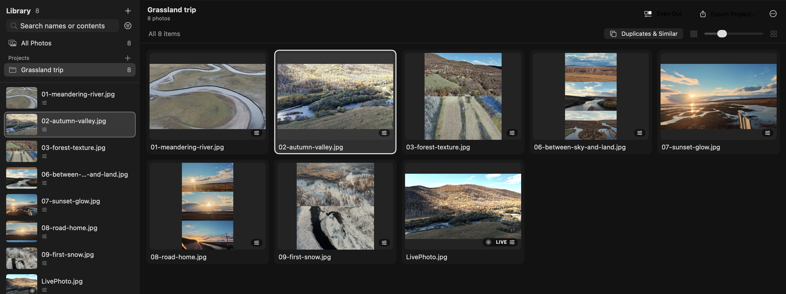</p>

**Change just part of the picture: local adjustments**
- A **gradient** to darken a sky, an **ellipse** to brighten a subject (or invert it to darken the surroundings), and a **brush** that adjusts wherever you paint (hold ⌥ to erase).
- **Subject** finds the people, animals and objects in front automatically (the same on-device detection as lifting a subject in Photos); invert it to work on the background instead.
- **Remove**: paint over a wire, a passer-by, litter or a dust spot and it's filled in from its surroundings (PatchMatch, computed on your Mac, no download).
- Each layer has its own exposure, contrast, highlights, shadows, whites, blacks, temperature, tint, saturation, vibrance, clarity, sharpness, noise reduction and dehaze. "Show mask" marks its area in red.
- Masks stick to the picture's content, so cropping or rotating later doesn't shift them.

<p align="center">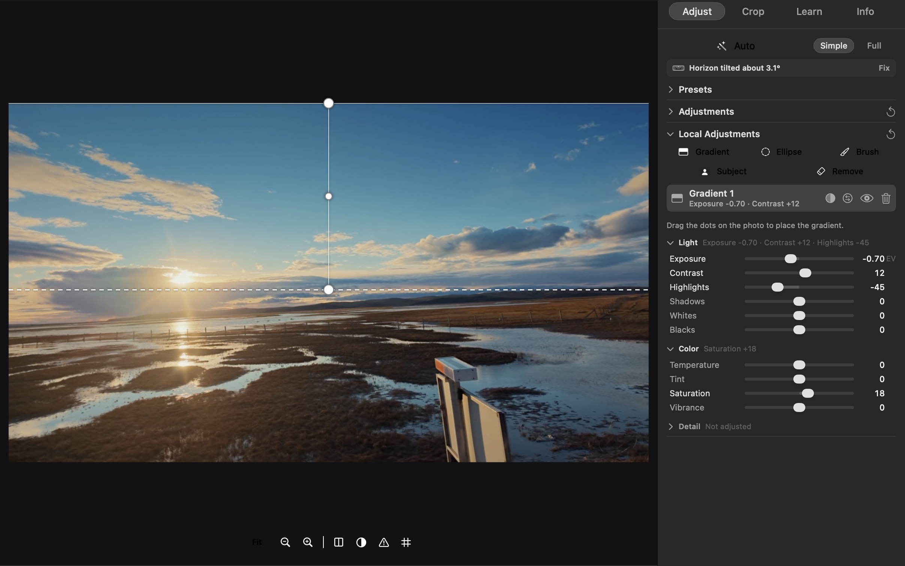</p>

**Like another photo's colors? Match colors and export LUTs**
- Pick a photo whose colors you like, and this photo's overall brightness and color move toward it (Reinhard color transfer in Lab space). The result is a LUT you can dial back with Strength, or undo.
- Export your adjustments as a `.cube` LUT for DaVinci Resolve, Final Cut Pro or Premiere. (Noise reduction, dehaze, clarity, sharpness, vignette and grain depend on neighboring pixels or position, so they can't be part of a LUT.)

**Cull: duplicates, similar shots and bursts**
- "Duplicates & Similar" finds files that are exactly the same (one photo imported twice, a Finder copy; videos too) and lets you reject or remove the extra copies in one click. Files on disk are never deleted.
- It also groups shots with nearly the same framing and colors, and photos one camera took less than 2 seconds apart.
- "Compare" shows 2–8 photos side by side: P to pick, X to reject, 1–5 to rate, "Keep Only This One". "Zoom to 100%" zooms them all to the same spot and pans them together, so you can tell which is sharpest.

<table>
<tr>
<td width="62%">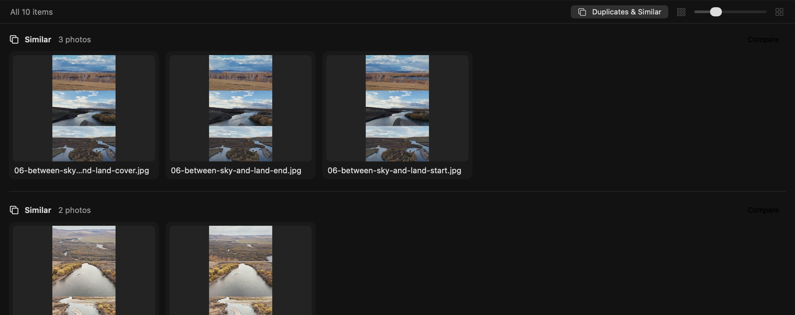</td>
<td width="38%">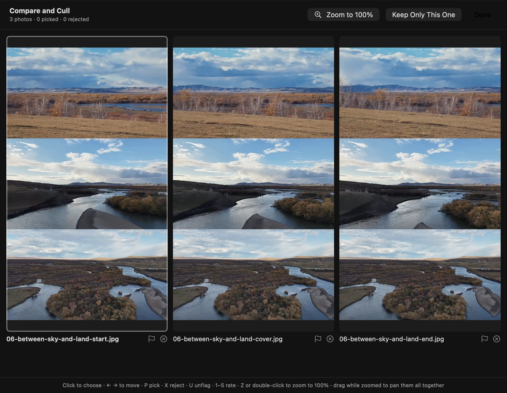</td>
</tr>
</table>

**Back to your iPhone when you're done**
- Exports **save straight into Photos** by default; with iCloud Photos on, they sync to your iPhone. Or save files, or share with the system share sheet.
- Trim a video to 3 seconds or less to make a real **Live Photo**, or combine several clips into a "Collage Live".
- JPEG / HEIC / PNG, optionally resized for social media. Capture time and camera info are kept; location is removed by default. Exports run in the background.
- **HDR photos stay HDR**: they export with a gain map, so highlights stay bright on HDR screens, edits included.
- **Export presets** (full size, social 2048 px, print 300 dpi, or your own), **file names** from `{name}` `{date}` `{seq}` `{width}` `{height}`, and an optional **text watermark** (position, color, size, opacity, shadow).

**Ready for DJI footage**
- Opens MP4 / MOV from DJI drones and cameras (including 10-bit HEVC). The Info tab lists codec, bit depth, bitrate, frame rate, color space and recording device.
- Imports DJI's official `.cube` creative LUTs (tested with the Pocket 3's Spring / Winter Pro).
- Trim videos and change speed (0.5–4×).

**Learn as you edit**
- Lucet reads the photo and points out what's really going on (where it's clipped, where there's a color cast, how far the horizon tilts), with an adjustment you can try in one click. Hover over a slider's name and the picture highlights only what it affects.
- **Interactive lessons**: a few minutes each, using animation and your own photo, with something to try and one quick question at the end. 13 lessons so far: the histogram, brightness zones, clipping, exposure, curves, white balance, HSL, aperture, shutter and ISO, focal length, video frame rate and shutter, and Log footage with LUTs. Open them from the Learn tab or the Learn menu. Where depth makes an idea clearer the scene is 3D and you can drag to turn it: your photo's brightness as a relief, its colors as a cloud in the RGB cube or the color cylinder, light passing through a lens, the wedge a focal length sees, a shutter as a slab of time, a sensor counting photons, the exposure settings as a box, and a tone curve reshaping that relief.
- **Five brightness zones**: darkest, shadows, midtones, highlights, brightest. Drag any light or dark slider and the histogram shows which part it changes.
- Choose Beginner, Intermediate or Advanced and the explanations change depth. Your learning history stays on your Mac.
- Optional **Ask About This Photo**: ask in plain language and Claude answers based on your photo. It needs your own Anthropic API key and is **off by default** (see Privacy).

<table>
<tr>
<td width="50%">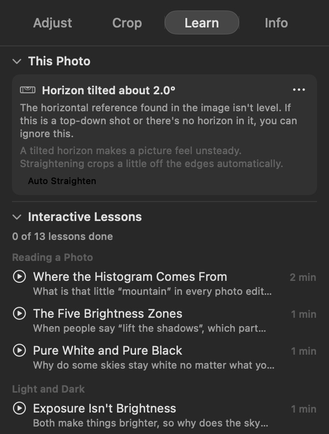</td>
<td width="50%">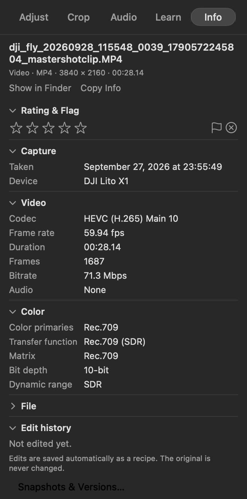</td>
</tr>
</table>

**When you want to go deeper**
- Switch to **Full** for scopes (histogram, waveform, parade, vectorscope), color wheels, curves, the HSL color mixer and creative LUTs, processed in a fixed DaVinci-style order where every step can be switched off to compare.
- **Film look**: Dehaze (clears distant haze, or adds it), Fade, Grain and Black & White, next to Vignette.
- Compare with the original, split view, clipping display, 100% zoom, named versions, copy and paste adjustments, and batch sync.
- **History**: every change is a named step ("Exposure +0.30", "Add Subject"). Click one to go back to it, even after quitting.

**Organize**
- Import folders or drag files into the window. Thumbnails show each photo as edited. Ratings 0–5, pick / reject, filters by type and rating. A HEIC or JPG with a same-name MOV becomes a Live Photo automatically.
- **Import from Photos** (⇧⌘I): browse your Photos library as a grid, click the shots you want (⇧-click for a range, double-click to look closer) or select exactly the first N, and Lucet copies just those originals in, iCloud ones included. Photos itself is never changed.
- **Search by content**: type "sky", "dog" or "sunset" (or 天空, 狗, 日落) and photos showing it appear, recognized on your Mac.
- If you move or rename an original in Finder, Lucet says "Original file not found"; point it to the new location and ratings and adjustments are kept.

## Install

**Requirements**: a Mac with Apple silicon (M-series) running macOS 15 or later. The interface is in English and Simplified Chinese and follows your Mac's language; you can also switch it under **Lucet 光集 › Language · 语言** in the menu bar.

1. Download the latest `Lucet-…-arm64.zip` from [Releases](https://github.com/YaoYao021123/lucet/releases/latest), unzip it and drag **Lucet 光集** into Applications.
2. The first launch is blocked ("can't verify the developer") because this version isn't notarized by Apple yet. To allow it: double-click it once and click Done → open **System Settings › Privacy & Security** → scroll to the bottom → click **Open Anyway** next to Lucet 光集. You only need to do this once.

To build it yourself (needs the Xcode Command Line Tools, `xcode-select --install`):

```sh
git clone https://github.com/YaoYao021123/lucet.git
cd lucet
bash scripts/run-workbench.sh
```

## Three steps

1. **Import**: drag a folder of photos or videos into the window.
2. **Adjust**: press `A` for Auto, pick a preset, fine-tune with six sliders. Press `\` to see the original.
3. **Save**: ⌘E to export and choose "Save to Photos". Come back any time; your adjustments are still there.

## Keyboard shortcuts

Press `?` or ⌘/ for the full list. The most common:

| Key | Action | Key | Action |
|---|---|---|---|
| `A` | Auto | `\` or `M` | Compare with original |
| `G` / `E` | Browse / Edit | `Y` | Side-by-side split |
| `0`–`5` | Rate | `J` | Highlight / shadow clipping |
| `P` / `X` / `U` | Pick / Reject / Unflag | `Z` | Fit ↔ 100% |
| ⌘Z / ⇧⌘Z | Undo / Redo | ⇧⌘C / ⇧⌘V | Copy / paste adjustments |
| ⌘E | Export current | `Tab` | Hide / show side panels |
| ⌥⌘C | Compare selected side by side | | |

Video: Space plays, `I` / `O` set in and out points, `C` sets the key photo. Single-key shortcuts don't fire while you're typing.

## Privacy

- Originals are **never changed**. Adjustments are saved as a small recipe file, and a new copy is made only when you export.
- No account, no analytics, **no photo uploads**. Subject detection and content search use Apple's on-device recognition; AI Look's model ships inside the app and runs locally. The library, recipes, edit history, photo fingerprints and content labels, and learning history live in `~/Library/Application Support/Guangji`.
- The only thing that goes online is the optional "Ask About This Photo". It's off by default; after you add your own key (stored in the Keychain), it sends data only when you click Ask: a thumbnail up to 1024 px on the long edge without capture or location info (can be turned off), plus image statistics and the current settings. It's billed to your account and may not be reachable from mainland China.

## Current limitations

Lucet is an early version. Honestly:

- Apple silicon Macs with macOS 15+ only.
- Not notarized by Apple yet; the first launch needs to be allowed by hand (see Install).
- HDR photos are previewed at standard brightness while you edit them (the export keeps HDR).
- Remove works best on smaller things; very large areas can show soft patches, so remove them in a few goes.
- Video trimming still uses sliders; no multi-track editing, transitions or titles. Local adjustments are for photos only for now.
- Common camera RAW files open, but they're treated as regular images, not developed as RAW; this is lightly tested.
- Log footage such as D-Log needs its conversion LUT imported by hand; automatic detection is planned.
- Imported folders aren't watched for new files.

## Feedback

Problems or feature ideas are welcome in [Issues](https://github.com/YaoYao021123/lucet/issues); a screenshot helps a lot.

## Development

Building, testing, translations, releases and the code structure: [docs/DEVELOPMENT.md](docs/DEVELOPMENT.md) (Chinese).

---

<sub>Lucet 光集 is independent software, not affiliated with or endorsed by DJI, Apple, Adobe, Anthropic or OpenAI. DJI, Mimo, iPhone, Live Photo, Lightroom, Photoshop, Claude, ChatGPT and other names belong to their owners.</sub>
