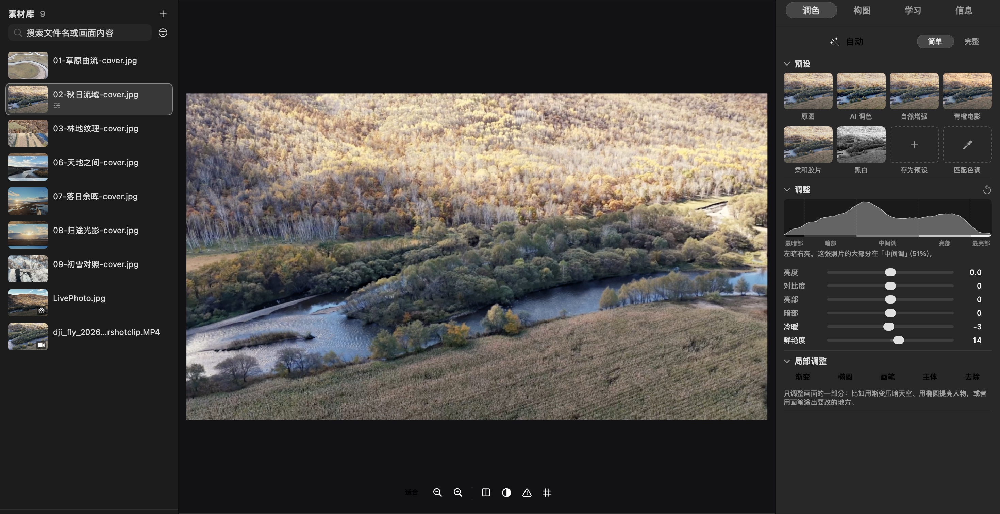
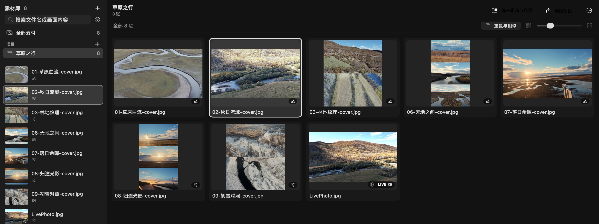
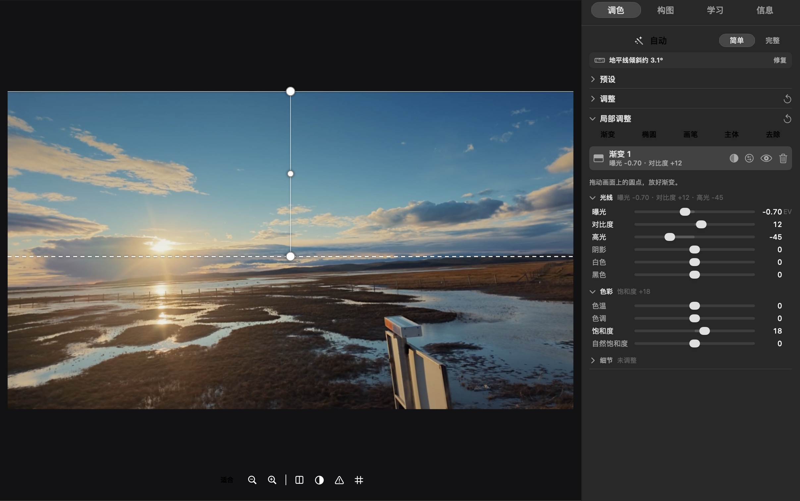
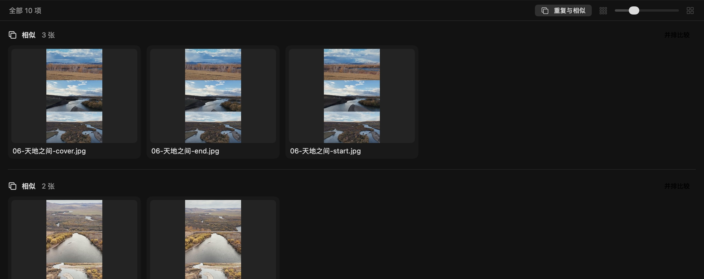
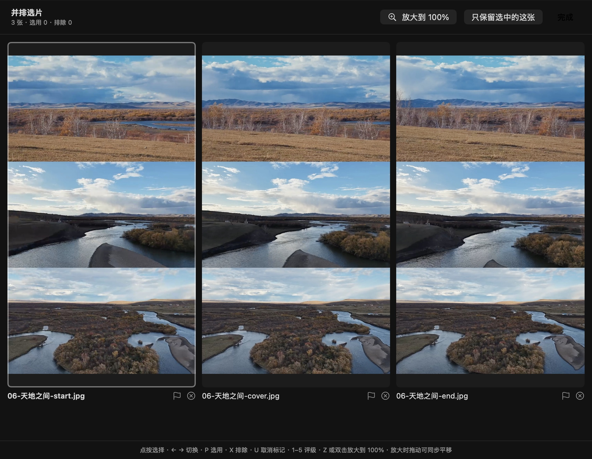

<div align="center">

[English](README.md) · **简体中文**


# Lucet 光集

**让每一个瞬间，自有光彩。**<br>
<sub>Let your moments shine.</sub>

在 Mac 上把照片调好看，不用先学摄影；想学的时候，它用你自己的照片讲给你听。

一键自动 · 六个滑块 · 预设一眼挑 · 调完存进「照片」<br>
照片、视频、Live Photo 都能调。给 DJI 和 iPhone 拍摄者的 Mac 调色工具。

</div>

<p align="center"></p>

### 调完是什么样

GitHub 上没法拖动，下面四张会自己来回扫；[官网](https://yaoyao021123.github.io/lucet/)上可以亲手拖中间那条线对比。都是光集的真实输出，没有额外修图。

<table>
<tr>
<td width="50%"><br><b>一键自动</b><br><sub>左原图，右「自动」</sub></td>
<td width="50%"><br><b>局部调整</b><br><sub>一个渐变压暗天空，地面不变</sub></td>
</tr>
<tr>
<td width="50%"><br><b>匹配色调</b><br><sub>向一张日落照片的颜色靠拢</sub></td>
<td width="50%"><br><b>去除</b><br><sub>涂了三笔，指示牌被周围的画面补上</sub></td>
</tr>
</table>

## 背后的故事

### 起点：一个只有手机版的 App

我用 DJI 拍素材，想调一下颜色和色调，才发现 DJI Mimo 只有手机版（iOS 和 Android）。想在大屏幕上调，只能回到手机上。

Lightroom、Photoshop 当然什么都能做，但打开的第一眼，就是几十个看不懂的滑块。

Lucet 光集想做中间那一块：**在 Mac 上，简单得像手机 App；想学的时候，也有人在旁边讲。** 默认只给你最常用的几样，其余的专业工具都在，只是先收起来。

### 先挑毛病，再加功能

最早的一版原型是 ChatGPT 写的，仓库的第一条提交就叫 “Baseline: ChatGPT prototype as received”。它能跑，但用起来又慢又乱。后来我在 Claude Code 里继续做，第一件事不是加功能，而是挑毛病，并且每个毛病都在 Mac 上实测：

- 把一个有 2000 个文件的文件夹加入素材库：原来要 6.9 秒，界面卡住；现在不到 0.01 秒。
- DJI Pocket 3 官方的 Spring / Winter Pro LUT：原来直接导入失败（文件标题是 GBK 编码）；现在能正常导入，解析时间从约 0.6 秒降到 0.02 秒。
- 导出照片：原来只能存 PNG，还丢掉全部拍摄信息；现在可以选 JPEG / HEIC / PNG，并保留拍摄时间和相机信息。

### 一句人话，一次修改

之后几乎每次改动，都从一句普通的话开始：「这个蓝色太亮了」「右边不够紧凑」「信息不够」「对新手不够友好」。AI 改，我看，再说，一轮一轮。官网和宣传视频也是这样做出来的：用网页技术写好，再渲染出来。

AI 也会错，而且错得很像回事。有一张白桌子上的拿铁照片，曾被判成「整体偏亮」，建议把曝光降 1.5 档；可白桌子本来就该亮。这样的问题，都是在真正用的时候一眼看出来，再修好、加上测试的。

### 为什么要「边调边学」

一键滤镜能让照片变好看，但下一次，你还是不知道为什么。

抖音上的摄影博主张小样用动画讲直方图、曲线和光圈，比任何说明书都清楚，可是只有几条视频，覆盖不了全部基础。于是我们把这种讲法放进了 App：用你自己的照片，看像素怎样按亮度堆成直方图，拖动光圈看背景怎样变虚。所有课程的文字和动画都是我们自己写、自己画的。大纲公开在 [docs/curriculum.md](docs/curriculum.md)，还在一课一课往上加。

### 名字

**Lucet** 是拉丁语，意思是「它在发光」。**光集**，是把光收集起来。一张照片，本来就是被留住的光。

### 网页版与合作伙伴

合作伙伴做了光集的网页版 Lucet（Apache-2.0 开源）。其中的相似照片分组、色彩匹配、调色导出为 LUT 和局部蒙版算法，已经用 Core Image 重写进了这个 Mac 版；网页版选用的 AI 调色模型 [Image-Adaptive-3DLUT](https://github.com/HuiZeng/Image-Adaptive-3DLUT)（Zeng 等，Apache-2.0）也在这里用纯 Swift 运行（见 `assets/models/NOTICE.md`）。

### 我们在意的

- 原片从不被修改；没有账号，不上传照片。
- 能做什么、还做不到什么，都写清楚（见下方「现在的限制」）。
- 欢迎一起做：想法、问题、你自己的照片故事，都可以到 [Issues](https://github.com/YaoYao021123/lucet/issues) 告诉我们。如果你也在用 [Claude Code](https://claude.com/claude-code) 或别的 AI 工具做东西，欢迎分享你的做法。

## 它能做什么

**简单开始**
- **自动（A）**：看这张照片本身的明暗和颜色，替你调好曝光、影调、白平衡和色彩。很克制：白底、雪景保持明亮，夜景保持夜景，日落保留暖色。不满意按 ⌘Z 撤销。
- **六个滑块**：亮度、对比度、亮部、暗部、冷暖、鲜艳度，每个都有一句人话解释。
- **预设缩略图**：每个预设直接用你这张照片预览，点一下套用。可以存自己的预设。
- **AI 调色**：为这一张照片生成调色。一个小型神经网络（Image-Adaptive-3DLUT）看过整张照片，混合三张学来的 LUT；在你的 Mac 上计算，默认强度 75%。
- **拖动裁剪**：在「构图」里直接在照片上拖裁剪框，也有拉直、旋转、镜像，地平线歪了会提醒。

**一件事，一套颜色：项目**
- 把一次旅行、一篇帖子或一组客片的照片放进一个**项目**。它们共用一套颜色：在任意一张上改冷暖、曲线或 LUT，整个项目都会跟着变；每张照片保留自己的曝光、裁剪和局部调整，例外的那张用「只这张」单独改。
- **统一明暗与色温**让每张照片的亮度和冷暖向整组的中间值靠拢，看起来像同一时间拍的一组；**导出项目**把已选用的（或全部）照片存进以项目命名的文件夹。
- 一张照片可以同时在几个项目里，每个项目里是各自的版本；它在素材库里自己的编辑保持不变。

<p align="center"></p>

**只改一部分：局部调整**
- **渐变**压暗天空、**椭圆**提亮主体（可反转压暗四周）、**画笔**涂到哪里调哪里（按住 ⌥ 擦除）。
- **主体**：自动找出画面里的人物、动物和前景物体（和「照片」里抠出主体用的是同一套本机识别），反转就改成调整背景。
- **去除**：涂抹电线、路人、垃圾或灰尘，用周围的画面自动填补（PatchMatch，在你的 Mac 上计算，不用下载模型）。
- 每一层有自己的曝光、对比度、高光、阴影、白色、黑色、色温、色调、饱和度、自然饱和度、清晰度、锐度、降噪和去雾；「显示蒙版」用红色标出范围。
- 蒙版跟着照片内容走，之后再裁剪、旋转也不会错位。

<p align="center"></p>

**喜欢哪张的颜色：匹配色调与导出 LUT**
- 选一张你喜欢它色调的照片，这张照片的整体明暗和颜色会向它靠拢（Lab 色彩空间里的 Reinhard 色彩迁移），结果是一个可调强度、可撤销的 LUT。
- 把调好的颜色导出成 `.cube` LUT，在 DaVinci Resolve、Final Cut Pro、Premiere 里继续用（降噪、去雾、清晰度、锐度、暗角和颗粒依赖周围像素或位置，不在 LUT 里）。

**挑片：重复、相似与连拍**
- 打开「重复与相似」，内容完全相同的文件（同一张照片导入了两次、Finder 里的副本，视频也算）会排在最前面，一键排除或从素材库移除多余的副本；硬盘上的文件不会被删除。
- 构图和颜色几乎一样的几张、同一台相机 2 秒内连拍的照片也会各自归成一组。
- 「并排比较」：2–8 张并排，P 选用、X 排除、1–5 评级，「只保留选中的这张」；「放大到 100%」让所有照片同时放大到同一位置、一起平移，比较清晰度。

<table>
<tr>
<td width="62%"></td>
<td width="38%"></td>
</tr>
</table>

**调完回到 iPhone**
- 导出默认**直接存入「照片」**，开启 iCloud 照片后同步到 iPhone。也可以存成文件，或用系统共享发给朋友。
- 视频裁到 3 秒以内可以做成真正的 **Live Photo**；还能把多段拼成一张「拼图 Live」。
- 格式 JPEG / HEIC / PNG，可缩小到社交平台尺寸；默认保留拍摄时间和相机信息，移除位置信息。导出在后台进行，不挡着你继续调。
- **HDR 照片导出后仍是 HDR**：带增益图导出，在 HDR 屏幕上高光依然明亮，调过色也一样。
- **导出预设**（原始尺寸、社交平台 2048、打印 300 dpi，或你自己存的），**文件名规则**可用 `{name}` `{date}` `{seq}` `{width}` `{height}`，还能加**文字水印**（位置、颜色、大小、不透明度、阴影）。

**为 DJI 素材准备**
- 能打开 DJI 无人机和相机的 MP4 / MOV（含 10 位 HEVC）。「信息」页列出编码、位深、码率、帧率、色彩空间和拍摄设备。
- 导入 DJI 官方的 `.cube` 风格 LUT（已用 Pocket 3 的 Spring / Winter Pro 实测）。
- 视频可以裁切、变速（0.5–4 倍）。

**边调边学**
- 光集会读这张照片，指出真正的问题（哪里过曝、哪里偏色、地平线歪了多少度），并给出可以一键试用的调整。悬停在滑块名上，画面会只高亮它影响的区域。
- **互动课**：几分钟一课，用动画和你自己的照片讲清原理，边看边动手，最后一道小题。比如看照片碎成像素、按亮度堆成直方图；拖光圈看开口变小、背景变清楚。目前 13 课，覆盖直方图、亮度分区、溢出、曝光、曲线、白平衡、HSL、光圈、快门与 ISO、焦距，以及视频的帧率与快门、Log 与 LUT，在「学习」页或菜单栏「学习」里打开。需要空间感的地方是三维的，可以用鼠标拖动转着看：把照片的亮度升成立体的柱子，把颜色看成红绿蓝立方体、色彩圆柱里的一团点，跟着光线穿过镜头，看焦距切出的楔形视野，把快门看成一块时间的玻璃板，看传感器一格一格数光子，把曝光设置放进一个立方体，看曲线怎样改写亮度地形。
- **五个亮度区**：最暗部、暗部、中间调、亮部、最亮部。拖动任何一个明暗滑块，直方图上都会标出它改变的是哪一段。
- 水平分「入门 / 进阶 / 专业」，讲解的深浅随之变化；学习记录只保存在你的 Mac 上。
- 可选的「问问这张照片」：用自然语言提问，由 Claude 结合这张照片回答。需要你自己的 Anthropic API 密钥，**默认关闭**（见下方隐私）。

**想深入时**
- 点「完整」，展开示波器（直方图、波形、分量、矢量）、色轮、曲线、HSL 色彩混合、风格 LUT，按 DaVinci 式的固定顺序处理，每一步都能单独开关对比。
- **胶片感**：去雾（去掉远处的雾气，也可以反向加雾）、褪色、颗粒、黑白，和暗角放在一起。
- 对比原片、左右分屏、溢出显示、缩放到 100%、命名版本、拷贝粘贴和批量同步调色。
- **历史记录**：每一次修改都是一步，有名字（「曝光 +0.30」「添加主体」），点一下就回到那时，关掉光集再打开也还在。

**整理素材**
- 导入文件夹或直接拖进窗口，缩略图网格显示已调色的样子。评级 0–5、选用 / 排除、按类型 / 评级筛选。同名的 HEIC/JPG 加 MOV 自动合成 Live Photo。
- **从「照片」导入**（⇧⌘I）：像在「照片」里一样浏览缩略图，点选想要的（⇧ 点按选一段，连按两下放大看），或者精确地选前 N 张，光集只把选中的原图复制进来，包括 iCloud 里的。「照片」本身不会被改动。
- **按画面内容搜索**：输入「天空」「狗」「日落」（或 sky、dog、sunset），画面里有它的照片就会出现，在你的 Mac 上识别。
- 原片在 Finder 里被移动或重命名，光集会提示「找不到原文件」，指给它新位置即可，评级和调整都保留。

## 安装

**系统要求**：Apple 芯片（M 系列）的 Mac，macOS 15 或更高。界面有中文和英文，跟随系统语言，也可以在菜单栏「Lucet 光集 › Language · 语言」里切换。

1. 到 [Releases](https://github.com/YaoYao021123/lucet/releases/latest) 下载最新的 `Lucet-…-arm64.zip`，解压，把「Lucet 光集」拖进「应用程序」。
2. 第一次打开会被系统拦下（提示无法验证开发者），因为目前的版本还没有经过 Apple 公证。放行方法：先双击打开一次，看到提示后点「完成」→ 打开「系统设置 › 隐私与安全性」→ 滚动到最下面 → 在「Lucet 光集」旁点「仍要打开」。只需要一次。

想自己构建（需要 Xcode 命令行工具，`xcode-select --install`）：

```sh
git clone https://github.com/YaoYao021123/lucet.git
cd lucet
bash scripts/run-workbench.sh
```

## 三步上手

1. **导入**：把照片或视频文件夹拖进窗口。
2. **调色**：按 `A` 自动，挑一个预设，用六个滑块微调。想看原图，按 `\`。
3. **存起来**：⌘E 导出，选「保存到 照片」。之后随时回来，调整都还在。

## 快捷键

按 `?` 或 ⌘/ 随时查看完整列表。常用的：

| 按键 | 作用 | 按键 | 作用 |
|---|---|---|---|
| `A` | 自动调整 | `\` 或 `M` | 对比原片 |
| `G` / `E` | 浏览 / 编辑 | `Y` | 左右分屏 |
| `0`–`5` | 评级 | `J` | 显示高光 / 暗部溢出 |
| `P` / `X` / `U` | 选用 / 排除 / 取消 | `Z` | 适合窗口 ↔ 100% |
| ⌘Z / ⇧⌘Z | 撤销 / 重做 | ⇧⌘C / ⇧⌘V | 拷贝 / 粘贴调色 |
| ⌘E | 导出当前 | `Tab` | 隐藏 / 显示两侧面板 |
| ⌥⌘C | 并排比较所选 | | |

视频：空格播放，`I` / `O` 入点出点，`C` 设为封面。单键快捷键在输入文字时不会触发。

## 隐私

- 原片**从不被修改**。所有调整保存为一份很小的配方文件，导出时才生成新的副本。
- 没有账号，没有统计，**不上传任何照片**。主体识别和按内容搜索用的是 Apple 的本机识别；AI 调色的模型随应用附带，在本机运行。素材库、配方、历史记录、照片指纹和内容标签、学习记录都在 `~/Library/Application Support/Guangji`。
- 唯一会联网的是可选的「问问这张照片」：默认关闭；你填入自己的密钥（保存在钥匙串）后，只有点「提问」时才发送，内容是一张最长边 1024 px、不含拍摄和位置信息的缩略图（可在设置里关掉），加上画面统计与当前参数。按你的账户计费；中国大陆网络可能无法直接访问。

## 现在的限制

Lucet 光集还是早期版本，诚实地说：

- 仅支持 Apple 芯片 Mac 与 macOS 15+。
- 还没有 Apple 公证，首次打开需要手动放行（见上方安装）。
- 调整 HDR 照片时，预览按普通亮度显示（导出会保留 HDR）。
- 「去除」适合较小的东西；涂得很大时可能出现发虚的区域，可以分几次去除。
- 视频的裁剪仍用滑块；不支持多轨道剪辑、转场、字幕；局部调整暂时只用于照片。
- 常见相机 RAW 文件可以导入，但只是按普通图片处理，并非 RAW 冲洗；这部分目前测试有限。
- D-Log 等 Log 素材需要自己导入对应的转换 LUT，自动识别还在计划中。
- 导入的文件夹不会自动监视新文件。

## 反馈

遇到问题或想要某个功能，欢迎到 [Issues](https://github.com/YaoYao021123/lucet/issues) 告诉我们，附上一张截图会很有帮助。

## 开发

构建、测试、发布与代码结构见 [docs/DEVELOPMENT.md](docs/DEVELOPMENT.md)。

---

<sub>Lucet 光集是独立开发的软件，与 DJI、Apple、Adobe、Anthropic、OpenAI 没有关联，也未获得它们的认可。DJI、Mimo、iPhone、Live Photo、Lightroom、Photoshop、Claude、ChatGPT 等名称属于各自的所有者。</sub>
